<!-- Perfil GitHub · César Moraes · as imagens animadas ficam em assets/ -->

  

  
  
  
  

  

## `01` &nbsp;Sobre mim

Sou **Senior QA Engineer** com mais de **15 anos de experiência** em tecnologia, unindo **Quality Engineering** e **Engenharia de Software**. Hoje lidero a qualidade de aplicações web, da estratégia de testes à validação em produção, incluindo **testes de segurança**.

Tenho uma trajetória multidisciplinar, com passagens por desenvolvimento e suporte, **Business Intelligence**, infraestrutura de TI, automação de processos e modelagem de dados, o que me dá uma visão sistêmica sobre arquitetura, integrações e fluxo de dados. Atualmente aprofundo minha atuação em **desenvolvimento backend** com **Node.js, TypeScript, SQL e arquitetura de APIs**.

> **Minha visão:** sistemas bem projetados nascem de decisões técnicas conscientes, validações sólidas e arquitetura bem estruturada.

🌐 Conheça mais em **[rochamoraes.digital](https://rochamoraes.digital)**.

<b>About me in English</b>

 

I'm a **Senior QA Engineer** with 15+ years in tech, bridging **Quality Engineering** and **Software Engineering**. I lead quality for web applications end to end — from test strategy to production validation, including security testing. My background spans development, support, Business Intelligence, IT infrastructure, process automation and data modeling, which gives me a systemic view of architecture, integrations and data flow. I'm currently deepening my **backend** work with **Node.js, TypeScript, SQL and API design**.

## `02` &nbsp;Áreas de atuação

Trabalho onde qualidade, dados e engenharia se encontram: da estratégia de testes à validação em produção, passando por automação, APIs e segurança.

  
  
  
  
  
  

## `03` &nbsp;Ferramentas do dia a dia

  

  

e também <b>Playwright · Appium · TestComplete · Insomnia · Apache JMeter · SQL Server · Chrome DevTools · Freshdesk · OWASP</b>

## `04` &nbsp;Formação

| Curso | Instituição | Período |
| :--- | :--- | :--- |
| **Bacharelado em Engenharia de Software** | Universidade Católica de Brasília | 2025 – 2029 *(em andamento)* |
| **MBA em IA, Data Science e Big Data para Negócios** | Ibmec | 2022 – 2023 |
| **Tecnólogo em Banco de Dados** | UNINTER Centro Universitário Internacional | 2020 – 2022 |
| **Tecnólogo em Análise e Desenvolvimento de Sistemas** | Universidade Positivo (UP) | 2012 – 2014 |

<b>Competências:</b> Liderança em qualidade · Comunicação técnica · Pensamento analítico · Visão sistêmica · Colaboração com times multidisciplinares · Proatividade · Aprendizado contínuo

## `05` &nbsp;Atividade

  
  

  

## `06` &nbsp;Vamos colaborar?

Gosto de trocar ideias sobre **qualidade de software, automação de testes, APIs, SQL, backend e segurança de aplicações**. Tem um projeto, um desafio de qualidade ou quer conversar? Me chama no [LinkedIn](https://www.linkedin.com/in/rochamoraes) ou por [e-mail](mailto:contato@rochamoraes.digital).

 

  
    
  

